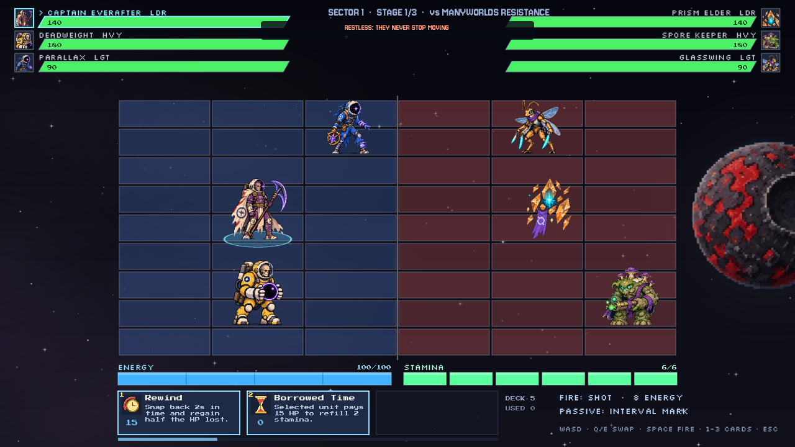
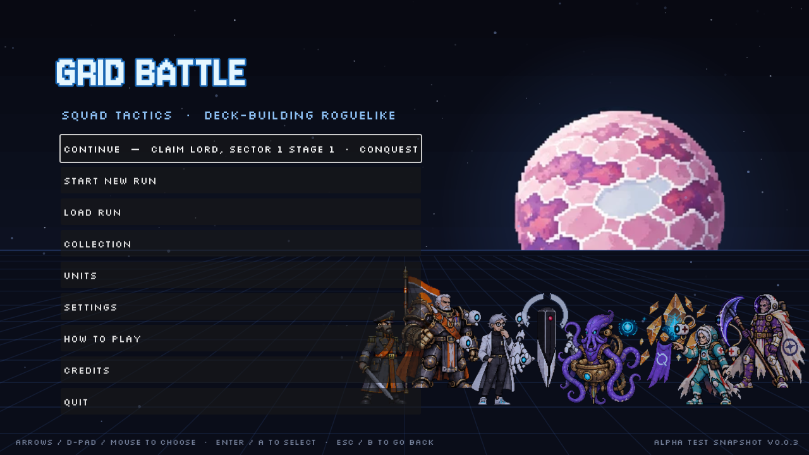
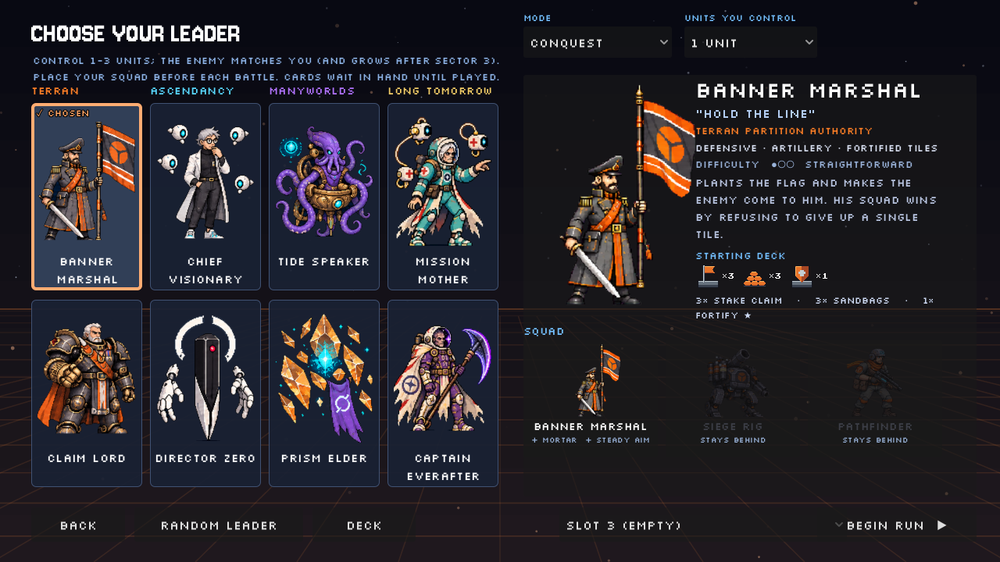
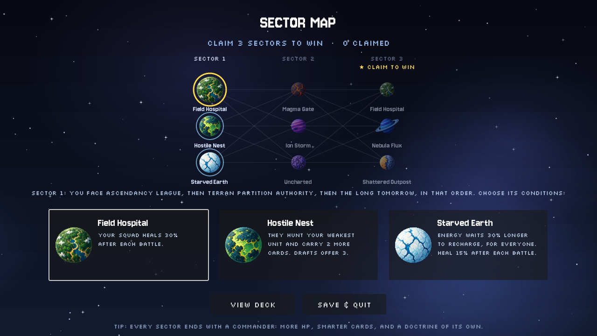
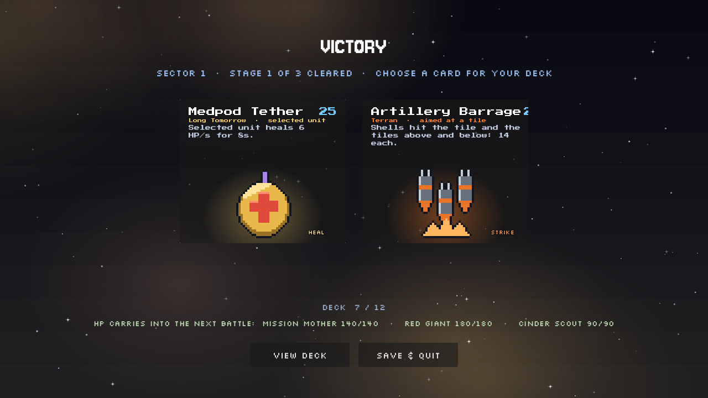
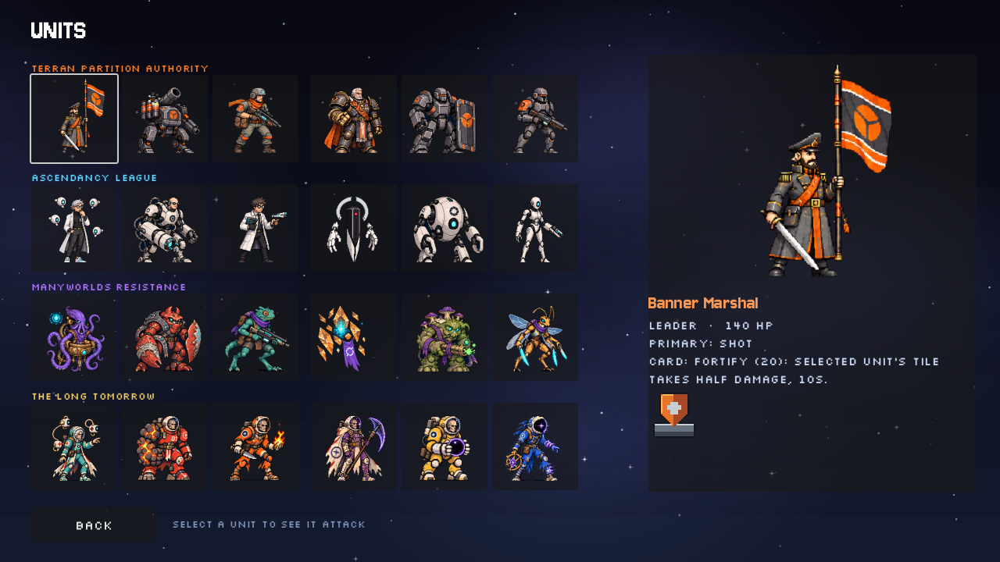
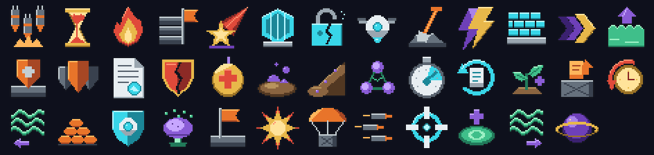

<div align="center">

# GRID BATTLE

**Real-time squad tactics on a split grid, with a deck-building roguelike run wrapped around it.**

*Four factions · eight leaders · 24 units · 38 cards · one shared grid, and the line down the middle is for sale.*




</div>

> *The sectors don't belong to the stars. They belong to whoever holds the ground, and four powers want it.*
>
> *The **Terran Partition Authority** enforces Old-Earth order in steel, fortifying every tile it takes. The **Ascendancy League** runs the frontier like a laboratory, where every battle is an experiment and every conquest a data point. The **Manyworlds Resistance** gathers refugees from a hundred worlds, bringing strange biology and terrain that fights back. **The Long Tomorrow** are lost colonists returned from the interval: decayed, patient, and carrying powers no one sent them out with.*
>
> *Every battlefield is a split verdict. One half is yours, the other is theirs, and the line between them moves. You take ground tile by tile, and you lose it the same way.*
>
> ***Pick your leader and claim your first sector.***

---

## Contents

- [About](#about)
- [Features](#features)
- [Screenshots](#screenshots)
- [How to play](#how-to-play)
- [Controls](#controls)
- [Factions and squads](#factions-and-squads)
- [Cards](#cards)
- [The run](#the-run)
- [Game modes](#game-modes)
- [Download and install](#download-and-install)
- [System requirements](#system-requirements)
- [Building from source](#building-from-source)
- [Project structure](#project-structure)
- [Development](#development)
- [Roadmap](#roadmap)
- [Known issues](#known-issues)
- [Playtesting and feedback](#playtesting-and-feedback)
- [Credits](#credits)
- [License](#license)

---

## About

Grid Battle is a fast, real-time grid battler. Two squads face each other on a board split down the middle: your three columns on the left, theirs on the right. You steer one unit at a time, dodge between rows, and fire across the line. Behind every shot sits a shared pool of **energy**. Behind every step sits a bar of **stamina**. Behind every big play sits a **hand of cards** that keeps drawing whether you're ready or not.

Wrapped around the fights is a roguelike campaign. Pick a leader and claim sectors across a star map. Draft a card after every win, and face a commander with its own doctrine at the end of each sector. Win the run and one card from your final deck joins your permanent collection. You can build new starting decks from that collection in **New Game+**.

> **Alpha.** Everything works end to end, but numbers are first-pass and art is still being redone. Expect balance swings, rough edges and the occasional saved run from an older version that needs migrating.

---

## Features

- ⚔️ **Real-time grid combat.** A 6-column board, three columns a side, up to nine rows deep. Movement costs stamina, shots cost energy, and the enemy telegraphs before it fires.
- 👥 **Squad control.** Field one, two or three units and swap between them on the fly. Each unit has a role (leader, heavy, light), a primary fire, a passive and a card.
- 🃏 **Cards that outlive their units.** When a unit falls, its card stays in your deck. You lose its passive and its gun, but never its trick.
- 🗺️ **Roguelike campaign.** Sectors of three battles, a branching star map with **13 sector modifiers**, **21 events** between fights, and a commander with a signature doctrine at every sector's end.
- 🎴 **Drafting and deck caps.** After each win, pick one card: one is offered from your own faction and one from the faction you just beat. Decks cap at 12, so taking a card can mean cutting one.
- 🧠 **Enemies play by your rules.** AI squads spend energy and stamina and play cards from their own decks. Each faction fights in its own style: dug in, methodical, restless or reckless. They get sharper every stage.
- ♾️ **Infinity and Beyond.** Won the run? Cash out, or keep claiming sectors until something finally stops you.
- 📚 **Meta-progression.** A permanent card collection, New Game+ levels up to NG+3 and beyond, and deck sculpting for NG+ runs.
- 🎮 **Keyboard and mouse, controller, and touch**, all supported in battle and in every menu.
- 🎨 **Hand-animated pixel art.** 24 units with idle, attack and move frames, 38 card icons, 20 planets, and pixel fonts throughout.
- 🎵 **Music and sound.** Every sound effect is synthesized in code. Each faction and the commander have their own music rotation of original and CC0 tracks.

---

## Screenshots

| | |
| :---: | :---: |
|  |  |
| **Title screen** | **Choose your leader:** squad, playstyle and starting deck |
|  |  |
| **Sector map:** pick your route and its conditions | **Draft:** one card from your faction, one from the enemy's |
|  |  |
| **Units:** the whole roster, animated | **Battle:** three against three on a full board |

---

## How to play

1. **Pick a leader.** Each leader brings a heavy and a light unit from their faction, plus a 7-card starting deck.
2. **Choose a sector** on the star map. Its modifier changes the rules for the next three battles.
3. **Fight.**
   - Move between your tiles to dodge incoming fire, which is telegraphed by an orange wind-up.
   - Line up with an enemy's row and shoot.
   - Swap to whichever unit is best placed.
   - Play cards from your hand of three.
4. **Draft** a card after every win. Damage carries between the three battles of a sector. A fallen unit comes back at 25% HP, and clearing the sector fully heals the squad.
5. **Beat the commander** at stage 3. It has 25% more HP, plays its cards smartly, and runs its faction's doctrine.
6. **Claim 3 sectors** to win the run (5, 7 or 9 on New Game+). Then take your reward or keep going into Infinity and Beyond.

### Core rules

| Resource | What it does |
| --- | --- |
| **HP** | Per unit. Lose all your units and the run is over. |
| **Energy** | Shared by the squad. Shots and cards spend it. It recharges after a short pause in spending. |
| **Stamina** | Shared and segmented: one chunk per step. It refills constantly. |
| **Hand** | Three cards. A timer draws new ones; how it behaves depends on the [game mode](#game-modes). |

**Marks.** Some units mark a target by landing **3 hits within 4 seconds**; a 3-pip counter shows the progress. What a mark does depends on who placed it. A Field Scholar mark refunds energy. A Captain Everafter mark detonates for half the damage dealt while it was active.

**Ground.** Some cards claim enemy tiles. You can only step onto a claimed tile if it connects to ground you already hold. When the ground reverts, anyone standing on it is pushed back.

**Standard shots** (for units without a unique primary):

| Role | Energy per shot | Damage |
| --- | --- | --- |
| Light | 8 | 5 |
| Leader | 8 | 8 |
| Heavy | 14 | 10 |

---

## Controls

| Action | Keyboard + mouse | Controller | Touch |
| --- | --- | --- | --- |
| Move | WASD | D-pad | — |
| Swap unit | Q / E | L1 / R1 (LB / RB) | Tap a unit's health bar |
| Shoot (hold to charge Charge Beam) | Space or right-click | A / Cross | — |
| Play card | 1 / 2 / 3, or click the card | X / Y / B (Square / Triangle / Circle) | Tap the card |
| Aim a tile card | Click the tile | Right stick (snaps tile to tile) | Tap the tile |
| Confirm an aimed card | (the click) | R2 / RT, or press the card again | (the tap) |
| Cancel aiming | Right-click or Esc | L2 / LT | Tap outside the grid |
| Pause | Esc | Start / Options | — |
| Menus | Arrows / mouse, Enter, Esc | D-pad, A to select, B to go back | Tap |

On a controller, cards work as **tap to arm, aim, confirm**. The right stick aims while the D-pad keeps moving your unit, so you never have to hold a face button while steering. On devices with both a controller and a touchscreen (such as a Steam Deck), the controller layout applies and screen taps act as mouse clicks.

---

## Factions and squads

Each faction fields two leaders. A leader always brings the same heavy and light unit, and each squad has one signature card.

### 🟧 Terran Partition Authority
*Old-Earth order enforced in steel. Holds ground, fortifies tiles, punishes anyone who steps out of line.*
**As the enemy:** DUG IN. They hold position and trade fire.
**Commander doctrine: Artillery Doctrine.** Shells arc onto your most crowded column every 14 s.

| Leader | Title | Heavy | Light | Style | Difficulty |
| --- | --- | --- | --- | --- | --- |
| **Banner Marshal** | "Hold the Line" | Siege Rig (Mortar) | Pathfinder (Steady Aim) | Defensive · Artillery · Fortified tiles | ●○○ |
| **Claim Lord** | "Take the Ground" | Breacher (Shield Up) | Standard Guard (Braced) | Aggressive · Area steal · Frontline | ●●○ |

### 🟦 Ascendancy League
*Clean-room science with a smile. Drones, protocols and experiments run on the battlefield as if it were a lab.*
**As the enemy:** METHODICAL. They line up on your weakest unit.
**Commander doctrine: Total Surveillance.** Your weakest unit is Analyzed every 12 s.

| Leader | Title | Heavy | Light | Style | Difficulty |
| --- | --- | --- | --- | --- | --- |
| **Chief Visionary** | "Run the Experiment" | Synapse Brute (Charge Beam) | Field Scholar (Analysis) | Setup · Drones · Big payoff | ●●● |
| **Director Zero** | "Execute Protocol" | Protocol Warden (Enforcer) | Courtesy Android (Courtesy Round) | Control · Lockdown · Precision | ●●● |

### 🟪 Manyworlds Resistance
*Refugees from a hundred worlds. Strange biology, stranger tactics, and terrain that fights back.*
**As the enemy:** RESTLESS. They never stop moving.
**Commander doctrine: Tidecaller.** Mud rises under your active unit every 12 s.

| Leader | Title | Heavy | Light | Style | Difficulty |
| --- | --- | --- | --- | --- | --- |
| **Tide Speaker** | "Call the Tide" | Reef Bulwark (Undertow) | Reed Runner (Ambush) | Displacement · Terrain · Mobility | ●●○ |
| **Prism Elder** | "Refract the Fight" | Spore Keeper (Spore Bloom) | Glasswing (Hit and Run) | Attrition · Angles · Damage over time | ●●● |

### 🟨 The Long Tomorrow
*Lost colonists returned from the interval. Decayed, patient, and carrying powers no one sent them out with.*
**As the enemy:** RECKLESS. They push toward the border.
**Commander doctrine: Burning Stars.** Each enemy unit shrugs off its first killing blow.

| Leader | Title | Heavy | Light | Style | Difficulty |
| --- | --- | --- | --- | --- | --- |
| **Mission Mother** | "Keep Them Alive" | Red Giant (Overheat) | Cinder Scout (Ember Shot) | Sustain · Burn · Risk and reward | ●●○ |
| **Captain Everafter** | "Never Turn Back" | Deadweight (Void Orb) | Parallax (Afterimage) | Gravity · Debuffs · Burst | ●●● |

<details>
<summary><b>Unique primary fires and passives</b></summary>

| Ability | Unit | Type | Effect |
| --- | --- | --- | --- |
| Mortar | Siege Rig | Primary | Lobbed shells that land 3 columns ahead; a shadow marks the tile just before impact. |
| Charge Beam | Synapse Brute | Primary | Hold to pour in energy; release fires a projectile that scales with it. |
| Courtesy Round | Courtesy Android | Primary | Cheap chip shot that curves into an adjacent row if its own is empty. |
| Undertow | Reef Bulwark | Primary | Slow, heavy shot that knocks its target back a column. |
| Refraction | Prism Elder | Primary | After a quick 2-row move, the next shot splits three ways. |
| Ember Shot | Cinder Scout | Primary | Sets the target's tile on fire; costs the Scout 3 HP. |
| Afterimage | Parallax | Primary | Fires from its current tile and the one it just left. |
| Steady Aim | Pathfinder | Passive | 3 hits in a row refund a stamina chunk. |
| Shield Up | Breacher | Passive | The first 2 hits take half damage, until the shield breaks. |
| Braced | Standard Guard | Passive | Shots get cheaper the longer he stands still. |
| Analysis | Field Scholar | Passive | Marks targets; your hits on them refund energy. |
| Enforcer | Protocol Warden | Passive | Fires back whenever an enemy breaks a protocol. |
| Ambush | Reed Runner | Passive | +50% damage on enemies that were just moved by force. |
| Hit and Run | Glasswing | Passive | A free move right after firing. |
| Overheat | Red Giant | Passive | +50% damage, but every shot costs it 2 HP. |
| Interval Mark | Captain Everafter | Passive | Marks detonate for half the damage dealt while marked. |

</details>

---

## Cards



There are **38 cards**: each squad's signature card, two starter cards per faction, and draftable cards that only appear as rewards. Every card has its own 32 px pixel icon.

<details>
<summary><b>Full card list</b></summary>

**Leader signature cards**

| Card | Cost | Effect |
| --- | --- | --- |
| Fortify | 20 | Selected unit's tile takes half damage, 10 s. |
| Claim | 35 | Take the enemy front column for 10 s. |
| Deploy Drone | 30 | Drone in front of the unit; fires down its row. |
| Issue Protocol | 25 | Enemy rule for 6 s: HALT, SILENCE or FORMATION. |
| Flood | 30 | Flood your row on the enemy side for 6 s. |
| Spore Bloom | 30 | Spreading spores on the enemy side, 9 s. |
| Medpod Tether | 25 | Selected unit heals 6 HP/s for 8 s. |
| Void Orb | 35 | Enemies drag each other on every move, 8 s. |

**Faction starter cards**

| Faction | Card | Cost | Effect |
| --- | --- | --- | --- |
| Terran | Stake Claim | 15 | Take an enemy tile for 7 s; walkable if it joins your ground. |
| Terran | Sandbags | 12 | Barricade in front of the unit stops 2 shots, 8 s. |
| Ascendancy | Overclock | 10 | Half-cost shots for 5 s, then jammed for 2 s. |
| Ascendancy | Containment Field | 20 | An enemy on the tile can't move for 3 s. |
| Manyworlds | Riptide | 15 | Pull the nearest enemy in your row 1 column closer. |
| Manyworlds | Mire | 15 | Mud tile for 8 s: leaving it costs 2 stamina. |
| Long Tomorrow | Borrowed Time | 0 | Selected unit pays 15 HP to refill 2 stamina. |
| Long Tomorrow | Rewind | 15 | Snap back 2 s in time and regain half the HP lost. |

**Draftable cards**

| Faction | Card | Cost | Effect |
| --- | --- | --- | --- |
| Terran | Artillery Barrage | 28 | Shells hit the tile and the tiles above and below: 14 each. |
| Terran | Hold the Line | 22 | Your squad takes 30% less damage for 5 s. |
| Terran | Requisition | 6 | Draw a card now. |
| Terran | Suppressing Fire | 18 | Enemies in the selected unit's row can't fire for 3 s. |
| Terran | Supply Drop | 20 | Crate on your ground; the first ally to reach it gets +20 HP, +15 energy. |
| Terran | Dig In | 20 | 8 s: takes 40% less damage, deals 25% more. Moving ends it. |
| Ascendancy | Target Lock | 14 | Analyze the enemy on the tile. |
| Ascendancy | Shield Drone | 22 | Selected unit gets a 30 HP barrier for 10 s. |
| Ascendancy | Recompile | 8 | Discard your hand and draw 3 fresh cards. |
| Ascendancy | Firewall | 20 | Containment on the tile and the tiles above and below, 3 s. |
| Ascendancy | Data Breach | 16 | The enemy on the tile pays double energy for its shots, 6 s. |
| Manyworlds | Undertow Surge | 24 | Push every enemy in your row back one column. |
| Manyworlds | Regrowth | 24 | Your squad heals 4 HP/s for 5 s. |
| Manyworlds | Mudslide | 22 | Mud on the tile and the tiles above and below, 8 s. |
| Manyworlds | Mycelial Link | 16 | For 6 s, damage to the selected unit is split across your squad. |
| Manyworlds | Tide Pool | 22 | Healing pool on your ground, 5 HP/s for 10 s. |
| Long Tomorrow | Last Stand | 16 | Selected unit can't drop below 1 HP for 4 s. |
| Long Tomorrow | Burn Bright | 0 | Selected unit pays 20 HP: gain 40 energy. |
| Long Tomorrow | Echo Strike | 18 | Selected unit fires its primary twice, free. |
| Long Tomorrow | Supernova | 30 | Pay 25% of current HP: 30 damage to every enemy in the row. |
| Long Tomorrow | Flash Forward | 10 | Leap up to 2 tiles forward, free; then can't move for 1.5 s. |
| Long Tomorrow | Collapse | 20 | The unit falls; every enemy in its row takes half its remaining HP. |

</details>

---

## The run

```
 Leader select ─► Sector map ─► Battle ─► Draft ─► (Event?) ─► Battle ─► Draft ─► Commander ─► Draft ─► Sector map ...
                                                                                                    │
                          claim 3 / 5 / 7 / 9 sectors ◄─────────────────────────────────────────────┘
                                     │
                     ┌───────────────┴────────────────┐
                Complete Run                 Infinity and Beyond
          (card joins your collection)   (endless, reward taken from your
                                          deck as it stood when you won)
```

- **Sectors.** Each sector is three battles, one against each of the other three factions, in an order shown on the map. Stage 3 is always the **commander**.
- **Sector modifiers (13).** Uncharted, Supply Cache, Fortified Foes, Veteran Foes, Field Hospital, Low Gravity, Ion Storm, Shattered Outpost, Tidal Surge, Nebula Flux, Hostile Nest, Starved Earth, Magma Gate. Each one changes the drafts, healing, enemy strength, stamina or energy, or the starting terrain.
- **Events (21).** After a mid-sector draft there's a chance of a short scene with 2–3 choices. Choices can heal or hurt, add, remove or discount cards, or change the next battle.
- **Difficulty** rises every stage. Enemies gain HP and bigger decks, act faster, dodge telegraphed shots, focus your weakest unit, and hold cards until they matter.
- **Losing** ends the run. There's no reward, and the next run starts fresh.

### Meta-progression

- **Collection.** Winning a run adds one random non-starter card from your final deck to a permanent collection.
- **New Game+.** Each win unlocks the next NG+ level. Every stage is 2 levels tougher per NG+ level, difficulty ramps 25% faster, and you need 2 more sectors per level (up to 9).
- **Deck sculpting.** On NG+ runs, swap starter cards for collected ones. The leader's signature card stays locked, and you can only use as many copies as you own.
- **Profile stats.** Runs won, best number of sectors in one run, and the highest NG+ unlocked.

---

## Game modes

| | **Conquest** (default) | **Evolution** |
| --- | --- | --- |
| Units you control | 1–3; at 2, you pick the heavy or the light | Always 3 |
| Enemy squad | Matches your count, then grows by one per sector after sector 3 | Always 3 |
| Board | Shrinks with smaller squads: 3, 6 or 9 rows | Full 9 rows |
| Start of battle | See the enemy's positions, place your units, then a 3-2-1 countdown | Starts at once |
| Hand | Cards wait until played; draws only while a slot is empty (9 s) | The draw timer never stops; a full hand **burns** a random card (7.5 s) |

When you play alone in Conquest, your leader borrows the squad's first unique primary as an alternate fire, and its first passive if the leader has none.

---

## Download and install

Download the latest build from **[Releases](https://github.com/DaveDw/grid-battle/releases/latest)**.

**Updates are built in.** From v0.0.5 on, the Windows and Linux builds check for a newer release when you reach the title screen. If there is one, an **Update to vX** button appears in the top-right corner: it downloads the new build, replaces the game and restarts. On macOS the button opens the release page instead.

| Platform | Package | How to run |
| --- | --- | --- |
| **Windows** | `GridBattle-Alpha-<ver>-windows.zip` | Unzip and run `GridBattle-Alpha-<ver>.exe`. SmartScreen may warn about an unsigned app: choose *More info → Run anyway*. |
| **Linux** | `GridBattle-Alpha-<ver>-linux.tar.gz` | Extract, then `chmod +x GridBattle-Alpha-<ver>.x86_64` and run it. |
| **macOS** (10.13+, Intel and Apple Silicon) | `GridBattle-Alpha-<ver>-macos.zip` | Unzip and drag *Grid Battle.app* to Applications. The app isn't notarized, so the first time, right-click it and choose **Open → Open**. If macOS says the app is damaged, run `xattr -cr "/Applications/Grid Battle.app"`. |

**Save data** is stored in Godot's user folder:

| OS | Location |
| --- | --- |
| Windows | `%APPDATA%\Godot\app_userdata\Grid Battle\` |
| Linux | `~/.local/share/godot/app_userdata/Grid Battle/` |
| macOS | `~/Library/Application Support/Godot/app_userdata/Grid Battle/` |

There are three run slots plus a separate `profile.json` that holds your collection and NG+ progress.

---

## System requirements

| | Minimum |
| --- | --- |
| OS | Windows 10+, a 64-bit Linux, or macOS 10.13+ |
| Graphics | A GPU with Vulkan (Windows and Linux) or Metal (macOS) support |
| Display | 1280×720; it scales up to any resolution, fullscreen or windowed |
| Input | Keyboard and mouse, any standard controller, or touch |
| Storage | About 450 MB |

---

## Building from source

**Requirements:** [Godot Engine 4.7.2](https://godotengine.org/), the standard build (not .NET). To export builds you also need the matching export templates.

```bash
git clone https://github.com/DaveDw/grid-battle.git
cd grid-battle
godot --path . --import
godot --path .
```

On Windows you can also double-click `Play Grid Battle.bat`; edit the Godot path inside it first.

**Exporting.** `export_presets.cfg` defines three presets: *Windows Alpha*, *Linux Alpha* and *macOS Alpha*.

```bash
godot --headless --path . --export-release "Linux Alpha" builds/linux/GridBattle-Alpha-0.0.5.x86_64
```

Or run `bash tools/build_release.sh` (Git Bash on Windows), which exports all three and packs the archives into `builds/release/`. Set the Godot path (`G`) and version (`V`) at the top of the script first.

**Publishing a release.** `bash tools/publish_release.sh <version> "notes"` creates the GitHub release `v<version>` and uploads the raw Windows and Linux builds (which the in-game updater downloads) plus the zip and tar.gz packages. It uses `GITHUB_TOKEN`, or the GitHub login Git Credential Manager already stores.

---

## Project structure

```
grid-battle/
├── scenes/                 Godot scenes: menus, battle (main.tscn), map, draft, events, run end
├── scripts/
│   ├── game.gd             Autoload "Game": all data (factions, units, kits, cards, modifiers,
│   │                       events, tips) plus run, save and profile logic
│   ├── battlefield.gd      Battle rules, AI, card effects, HUD
│   ├── unit.gd             A unit on the grid: HP, movement, firing, marks
│   ├── fighter_sprite.gd   Frame animation (idle / attack / move) with a procedural fallback
│   ├── sfx.gd              Autoload "Sfx": every sound effect synthesized in code
│   ├── music.gd            Autoload "Music": per-context tracks with cross-fades
│   └── ...                 One script per screen (sector_map, draft, deck_view, settings_panel, ...)
├── assets/
│   ├── sprites/<faction>/  Unit art and animation strips (+ _frames.json metadata)
│   ├── cards/              38 card icons (32 px, drawn at 4×)
│   ├── planets/            20 planet sprites for the map and battle backdrops
│   ├── fonts/              Press Start 2P, Silkscreen, Jersey 10 (OFL) + .tres wrappers
│   └── music/              gen/ (generated in code) and lib/ (CC0 tracks)
├── tools/                  Art import, sprite extraction, music generation, screenshot rigs
├── art_incoming/           Raw art drops before import (unit frames, card sources)
├── kb/                     Shared knowledge base for the AI collaborators: briefs, proposals,
│                           decisions, protocols, roster, NEXT.md (current state)
├── docs/screenshots/       Images used in this README
├── DESIGN.md               The full design document, with every rule and number
├── PROGRESS.md             Build history, session by session
└── export_presets.cfg      Windows / Linux / macOS export settings
```

---

## Development

Grid Battle is built by a human director working with a small team of AI collaborators. Each one has a defined job:

| Role | Who |
| --- | --- |
| Game design and direction | DaveDw |
| Programming, systems, card art, review and the art pipeline | Claude (Anthropic) |
| Programming (early stages) | Hermes Agent running Qwen locally |
| Unit animation frames | Codex |
| Card, event, modifier and tip proposals; copy editing | Gemma via Hermes, running locally |

They coordinate through the knowledge base in [`kb/`](kb/):
- **briefs** are the tasks handed out;
- **proposals** are what comes back;
- **decisions** record what the director approved;
- **protocols** are checklists, such as how an idle animation is reviewed;
- [`kb/NEXT.md`](kb/NEXT.md) always says where things stand.

**Art pipeline.**
1. Unit frames are drawn onto a magenta key in `art_incoming/`.
2. `tools/import_frames.gd` keys out the background, cuts the cells, aligns feet, scales by body height, and writes `<unit>_frames.json` with a muzzle point.
3. Each new idle is reviewed frame by frame before it's imported.

**Testing.** Systems were built in stages, each with a scripted probe that checks every rule (kits, cards, sectors, drafts, events). Screens are checked by rendering them headless: `tools/shot.gd` and the scene rigs in `tools/rigs/check/`. These rigs produced the screenshots in this README.

---

## Roadmap

- [x] Core grid combat, squads, energy and stamina
- [x] Kits for all 24 units, 38 cards
- [x] Sectors, drafting, deck cap, enemy scaling
- [x] Sector map, 13 modifiers, winning a run, Infinity and Beyond
- [x] Collection, New Game+, deck sculpting
- [x] Faction AI styles, commanders, doctrines, 21 events
- [x] Controller and touch support
- [x] Music and synthesized sound
- [x] Pixel fonts and card art; all 24 idle animations redone
- [x] Self-updating builds (GitHub Releases)
- [ ] Balance pass on every number (all current values are first-pass)
- [ ] Director Zero's kit: still under test
- [ ] Unit bios and more faction-specific events
- [ ] Remaining attack and move animation fixes
- [ ] Steam Deck verification
- [ ] Public release builds

---

## Known issues

- Some units with purple art may show a faint magenta fringe left over from the background key.
- Balance is untuned. Some squads, especially the ●●● leaders, can feel much stronger or weaker than others.
- Saves from much older alphas are migrated automatically, but may start at sector 1.

---

## Playtesting and feedback

Thanks for testing. The most useful things to tell us are:

- what felt **unfair**, and what felt **too easy**;
- cards you **never wanted** to pick;
- any **crash or stuck screen**, and what you were doing when it happened;
- your OS, and whether you played on keyboard, controller or touch.

Open an issue on GitHub, or send your notes straight to the developer.

---

## Credits

| | |
| --- | --- |
| **Game design and direction** | DaveDw |
| **Programming** | Claude (Anthropic) · Hermes Agent (Qwen, local) |
| **Character art** | Faction sprite sheets: Terran Partition Authority · Ascendancy League · Manyworlds Resistance · The Long Tomorrow |
| **Unit animation** | Codex |
| **Card art** | Claude (Anthropic) |
| **Fonts** | [Press Start 2P](https://fonts.google.com/specimen/Press+Start+2P) (CodeMan38), [Silkscreen](https://fonts.google.com/specimen/Silkscreen) (Jason Kottke), [Jersey 10](https://fonts.google.com/specimen/Jersey+10) (Sarah Cadigan-Fried), all under the SIL Open Font License |
| **Sound** | Synthesized in code (`scripts/sfx.gd`) |
| **Music** | Original score generated in code (`tools/compose_music.gd`), plus CC0 tracks from [OpenGameArt.org](https://opengameart.org): "Outer Space Loop" by wipics · "Claimed by the Void" mix by vitalezzz & tricksntraps · "Space Battle" and "Ocean Trance" by MintoDog · "Kohle und Stahl" and "Some Militaristic Tune" by Spring Spring · "Ganymede" by congusbongus · "Hunter-class Lifeform" by vitalezzz · "Energy Storm" by iamoneabe · "The Plague" by Indieteur (with added drums) · "Technovillain" by Joth · "The True Villain Emerges" by Umplix · "Carnage & Boss Battle" by Centurion of war & nene |
| **Engine** | [Godot Engine](https://godotengine.org) 4.7 (MIT) |
| **Inspired by** | Grid battlers and deck-building roguelikes |

---

## License

There is no license file yet, so the game's code and original art are **all rights reserved** by the author until one is chosen. Third-party assets keep their own licenses:

- The fonts are under the SIL Open Font License; the full texts are in `assets/fonts/OFL-*.txt`.
- The music library tracks are CC0.
- Godot Engine is MIT-licensed.

<div align="center">

*Hold the line. Take the ground. Never turn back.*

</div>
